# LangFlip

**Fix accidentally mistyped text across keyboard languages in-place — in any app, including command-line terminals — with a single hotkey.**



---

## The Problem

If you regularly type in two keyboard languages on Windows 11 (for example, **English** and **Hebrew**, or English and Russian/Ukrainian/Greek), you know this daily frustration:

1. You start typing a sentence, URL, or shell command — e.g., intending to type `hello world` or `dir`.
2. Halfway through, you look up and see gibberish: `יקךךם 'םרךג` or `גןר`.
3. You have to stop, delete everything you typed, switch the keyboard layout (`Alt+Shift` / `Win+Space`), and retype it from scratch.

**LangFlip** eliminates that loop. Hit one hotkey (**`Pause/Break`** by default) and LangFlip:
1. Switches your active keyboard layout to the other configured language (and **confirms** Windows accepted the switch *before* erasing anything),
2. Erases the mistyped burst,
3. Replays your physical keystrokes under the new layout so the text flips cleanly in-place, and
4. Leaves you in the right language to keep typing seamlessly.

Pressing the hotkey a second time cleanly round-trips the text back.

---

## Why LangFlip? (What It Replaces)

Several utilities have tried to solve this over the years, each with trade-offs LangFlip was built to avoid:

| Existing Tool | Limitation | How LangFlip Differs |
|---|---|---|
| **LangOver / הפוך על הפוך (*Hafoch Al Hafoch*)** | Legacy Windows 7-era freeware; unmaintained and breaks in modern Windows 11 apps (WinUI Notepad, Chromium, Terminal). | Built natively for **Windows 11** (including WinUI 3 Notepad paced injection and Edge/Chrome Omnibox inline-autocomplete handling). |
| **Punto Switcher / Caramba Switcher** | Closed-source / freemium; automatic switching frequently misfires on code, acronyms, and terminal commands; telemetry concerns. | **100% open-source, manual-first** (only acts when you press the hotkey), zero network/telemetry, and keystrokes stay strictly in volatile RAM. |
| **Mahou** | Mature Windows tool, but Windows-only (.NET/C#) with a sprawling legacy UI. | **Written in Rust** (~2.8 MB single native binary, ~3 MB RAM) with a cross-platform-architected core (`langflip-core`) decoupled from thin OS adapters. |
| **Clipboard-based scripts / fixers** | Rely on `Ctrl+C` / `Ctrl+V`, which break in PowerShell, CMD, WSL, and SSH, and clobber your clipboard. | Uses **physical scan-code replay** (`SendInput`), so it works in terminals, browsers, and native apps without touching your clipboard. |

---

## Built in Rust with Safety & Privacy First

- **Language & Architecture**: Implemented in **Rust** (pinned `1.100.0`) as a 3-crate workspace:
  - `langflip-core` — 100% OS-independent domain engine (key classification, hotkey matching, layout resolution, bounded buffer, injection planner, config loader) with strict TDD unit & integration tests runnable natively on Linux.
  - `langflip-platform-win` — thin Windows 11 Win32 adapter (low-level hooks, `GetGUIThreadInfo` + `WM_INPUTLANGCHANGEREQUEST` layout switching, UI Automation Omnibox selection check, native system tray & Settings dialog).
  - `langflip-app` — thin GUI-subsystem binary (`langflip.exe`, no open console window).
- **Safe Conversion Ordering**: Switches and confirms the target layout *before* sending a single Backspace, and cancels cleanly if focus or input changes — so rejected switches never delete your text.
- **Privacy by Design**: Bounded RAM-only keystroke buffer with redacted `Debug`; keystrokes are never written to disk, sent over the network, or logged in any build.
- **System Tray Utility**: Launches silently into the Windows 11 taskbar notification area with a custom swap-arrow icon, single-instance guard, and a right-click menu (**Settings...** and **Exit**).

---

## Configuration Options

LangFlip works out of the box with zero configuration (defaulting to **English ↔ Hebrew** and **`Pause/Break`**), and can be configured either through the **Settings dialog** or via **`langflip.toml`**.

### 1. System Tray Settings Dialog
Right-click the LangFlip icon in the Windows 11 system tray and choose **Settings...**:
- **Primary language** & **Secondary language** — populated automatically from your installed Windows keyboard layouts.
- **Trigger hotkey** — choose any supported physical key (`Pause`, `ScrollLock`, `Space`, `F1`–`F12`, `A`–`Z`) plus optional `Ctrl`, `Alt`, `Shift`, and `Win` modifiers.
- Clicking **Save** persists to `langflip.toml` and applies **immediately** with no restart required.

### 2. Configuration File (`langflip.toml`)
Lookup precedence:
1. `langflip.toml` next to `langflip.exe` *(portable override)*
2. `%APPDATA%\langflip\langflip.toml` *(Windows user config directory)*
3. Built-in defaults

See [langflip.example.toml](langflip.example.toml) for a ready-to-copy template:

```toml
[layouts]
# Primary language tags ("en", "he", "ru"), BCP-47 tags ("en-US", "en-IN", "he-IL"),
# or exact Windows KLIDs ("00000409" US, "00004009" India, "0000040D" Hebrew,
# "0002040D" Hebrew Standard, "0003040D" Hebrew Standard 2018).
primary = "en"
secondary = "he"

[hotkey]
# Physical key name (layout-independent): "Pause", "ScrollLock", "Space", "F1"-"F12", "A"-"Z"
key = "Pause"
ctrl = false
alt = false
shift = false
meta = false

[behavior]
# Maximum buffered keystrokes per burst (valid range: 1..=512).
max_buffer_len = 128
# Per-keystroke replay delay in ms (valid range: 0..=10; default 1 ms).
replay_delay_ms = 1
# When true, pressing the hotkey on an empty buffer toggles the keyboard layout.
toggle_on_empty_buffer = true
```

| Section & Key | Default | Valid Values | Description |
|---|---|---|---|
| `layouts.primary` | `"en"` | Language tag, BCP-47 tag, or exact OS layout ID | First layout in the toggle pair (must differ from `secondary`). |
| `layouts.secondary` | `"he"` | Language tag, BCP-47 tag, or exact OS layout ID | Second layout in the toggle pair. |
| `hotkey.key` | `"Pause"` | `Pause`, `ScrollLock`, `Space`, `F1`–`F12`, `A`–`Z` | Physical trigger key (matched by scan code, independent of active layout). |
| `hotkey.ctrl` / `alt` / `shift` / `meta` | `false` | `true` / `false` | Optional modifier keys required alongside `hotkey.key`. |
| `behavior.max_buffer_len` | `128` | `1..=512` | Hard upper bound on buffered keystrokes per burst. |
| `behavior.replay_delay_ms` | `1` | `0..=10` | Per-keystroke pacing in milliseconds during replay. |
| `behavior.toggle_on_empty_buffer` | `true` | `true` / `false` | Toggle the active keyboard layout when the hotkey is pressed on an empty buffer. |

*(Invalid syntax or out-of-range values fail fast at startup with a clear error message. Optional `--metrics` CLI flag attaches to a parent console to print non-sensitive timing diagnostics.)*

---

## Building from Source (Isolated Rust Toolchain)

All host and toolchain dependencies are declared in `toolchain/deps.conf` and `rust-toolchain.toml`, and installed strictly inside `<repo>/.toolchain/` without touching `~/.rustup`, `~/.cargo`, or shell profile files:

```bash
# 1. Audit host dependencies and bootstrap the isolated Rust toolchain
./scripts/setup-env.sh --install-system-deps

# 2. Run all core unit & integration tests natively on Linux
./scripts/cargo.sh test --workspace --locked

# 3. Run host + Windows cross-target Clippy lints
./scripts/cargo.sh clippy --workspace --all-targets --locked -- -D warnings
./scripts/cargo.sh clippy --target x86_64-pc-windows-gnu --workspace --locked -- -D warnings

# 4. Cross-compile standalone Windows 11 release binary
./scripts/cargo.sh build --release --locked --target x86_64-pc-windows-gnu -p langflip-app
# Output: target/x86_64-pc-windows-gnu/release/langflip.exe
```

See [specs/001-mvp-layout-converter/quickstart.md](specs/001-mvp-layout-converter/quickstart.md) for the full developer quickstart and verification checklist.

---

## Roadmap

- **Completed**:
  - **Spec 001**: Isolated Rust toolchain, cross-platform core engine, Windows 11 hook/injector/layout adapter (Notepad, browsers, Windows Terminal/PowerShell).
  - **Spec 002**: Browser address bar (Edge/Chrome Omnibox) inline-autocomplete detection via Windows UI Automation.
  - **Spec 003**: Native Windows 11 system tray icon, right-click menu (**Settings...** / **Exit**), live-reload Settings dialog, and single-instance guard.
- **Planned**:
  - Cursor-aware buffer editing (`Left`/`Right`/`Home`/`End`/`Delete` without resetting the burst).
  - Focus-aware multi-line buffers (`Enter` survives in multi-line editors while still resetting in terminals & single-line fields).
  - Automatic 2-layout OS discovery & Windows logon auto-start toggle.
  - macOS and Linux platform adapters reusing `langflip-core`.
